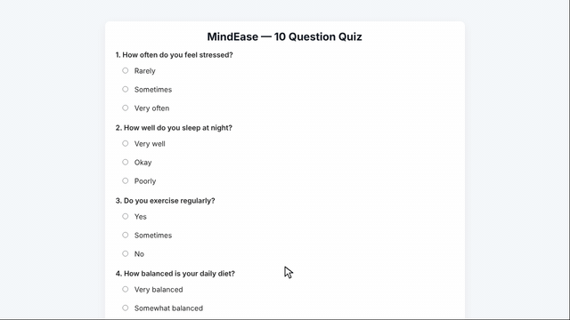
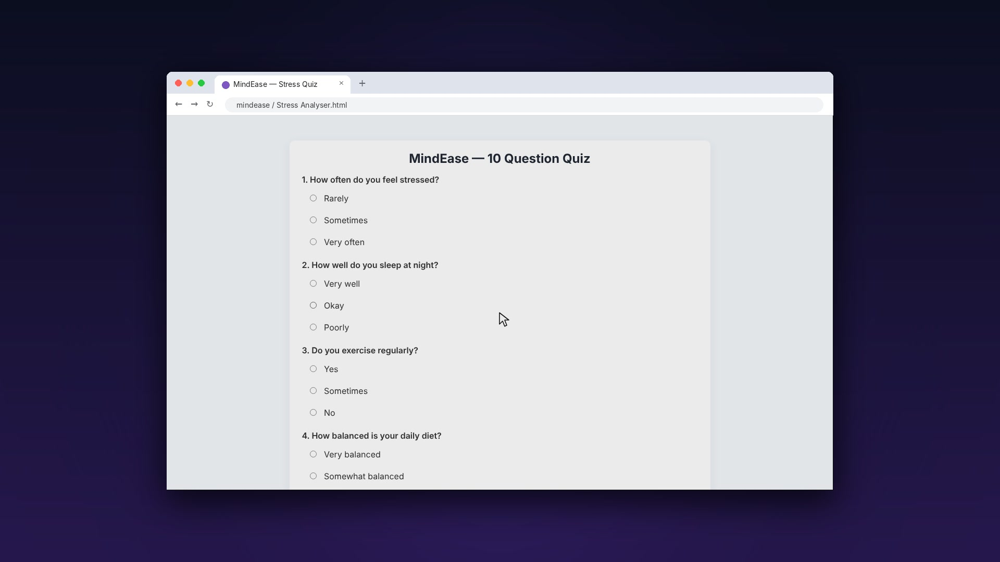
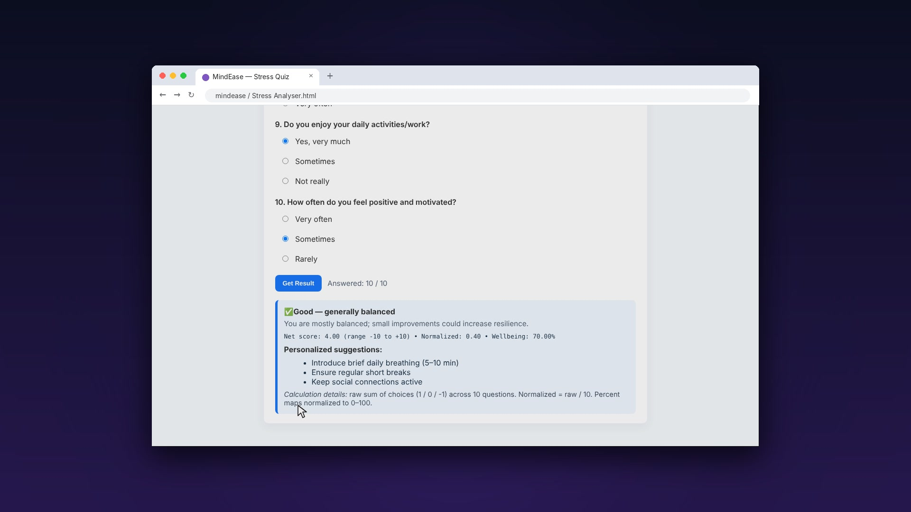
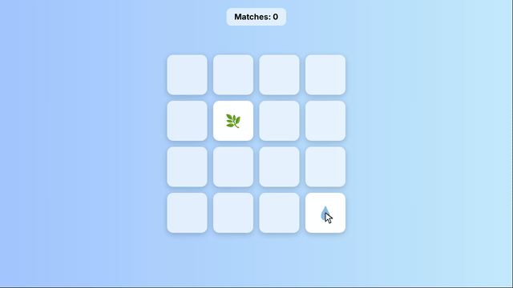
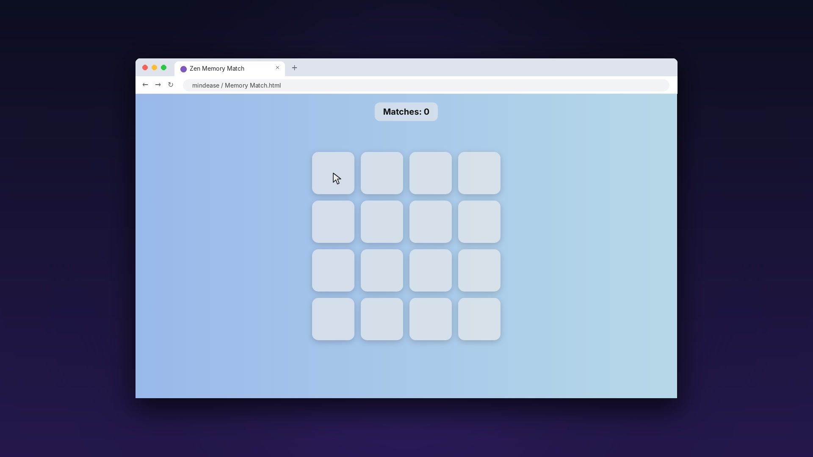
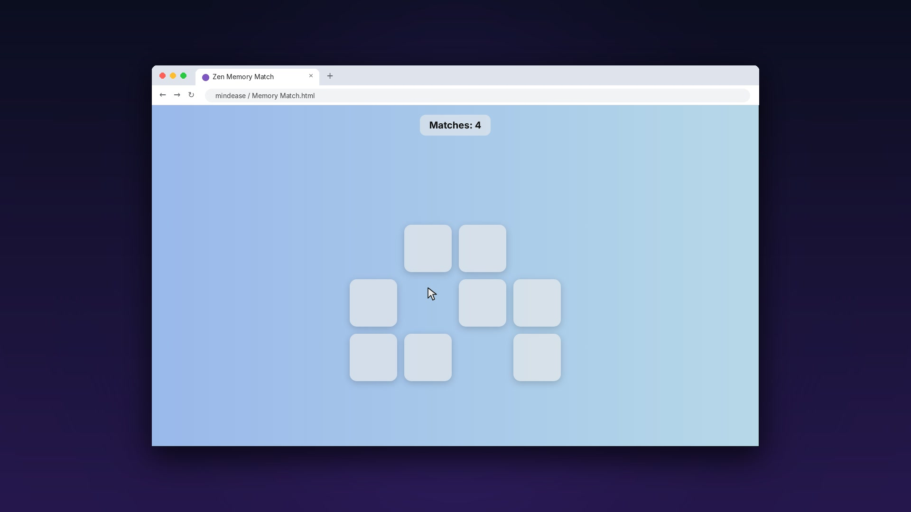

# 🌿 MindEase

**MindEase** is a small collection of calming, browser-based wellbeing mini-apps built with plain **HTML, CSS and JavaScript**: no frameworks, no installs, no data leaves your device.

| App | What it does |
| --- | --- |
| 🧘 **Stress Analyser** | A 10-question self-check quiz that calculates a precise wellbeing score and gives personalised suggestions |
| 🃏 **Zen Memory Match** | A relaxing nature-themed memory card game to give your mind a short, focused break |


> ⚠️ MindEase is a self-reflection tool, **not** a medical or diagnostic instrument. If you are struggling, please reach out to someone you trust or a qualified professional.

---

## 🧘 Stress Analyser

<p align="center">
  
</p>

### Features
- **10 lifestyle questions** covering stress, sleep, exercise, diet, breaks, social support, relaxation, workload, enjoyment and motivation
- **Live progress counter:** "Answered: x / 10" updates as you go
- **Validation:** asks you to finish all questions before scoring
- **Precise scoring:** each answer is worth +1 / 0 / −1, giving
  - **Net score** (range −10 to +10)
  - **Normalised score** (−1 to +1)
  - **Wellbeing %** (0–100%)
- **Four result bands** with tailored suggestions:

| Wellbeing % | Result |
| --- | --- |
| ≥ 75% | Very good: low stress |
| 55 – 74.99% | Good: generally balanced |
| 35 – 54.99% | Moderate: some stress detected |
| < 35% | High stress: take action |

| Start | Result |
| :---: | :---: |
|  |  |

---

## 🃏 Zen Memory Match

<p align="center">
  
</p>

### Features
- **16 cards / 8 pairs** of calming nature emojis 🌸🌿☀️🌙⭐🍀💧🦋
- Cards are **shuffled every game**
- Matching pairs fade away; mismatches flip back after a moment
- **Live "Matches" counter**
- Soft sky-blue gradient and gentle animations for a relaxing feel

| Start | Finding pairs |
| :---: | :---: |
|  |  |

---

## 🚀 Getting Started

No installation needed:

1. Download or clone this repository.
2. Open either file in any modern browser:
   - `🔃 Stress Analyser/🔃 Stress Analyser.html`
   - `🔃 Memory Match/🔃 Memory Match.html`

> Tip: you can host it for free with **GitHub Pages** (Settings → Pages → deploy from the `main` branch) and share a live link.

---

## 🛠️ Tech Stack

- **HTML5:** structure and form controls
- **CSS3:** gradients, grid layout, transitions
- **Vanilla JavaScript:** game logic, scoring and DOM updates

---

## 📂 Project Structure

```
mindease/
├── 🔃 Stress Analyser/
│   └── 🔃 Stress Analyser.html
├── 🔃 Memory Match/
│   └── 🔃 Memory Match.html
└── assets/            # screenshots and preview GIFs for this README
```

---

## 🔮 Ideas for Future Improvements

- A single MindEase home page linking all tools
- Guided breathing timer
- Saving quiz history (localStorage) to track wellbeing over time
- Move counter, timer and a "You win!" screen for Memory Match
- Mobile-friendly layout and dark mode

---

## 👤 Author

**Somya Ranjan Sahoo** · [GitHub](https://github.com/somyaranjansahoo6422) · [Portfolio](https://somyaranjansahoo6422.github.io/projects/mindease/)

If you like this project, consider giving it a ⭐!
